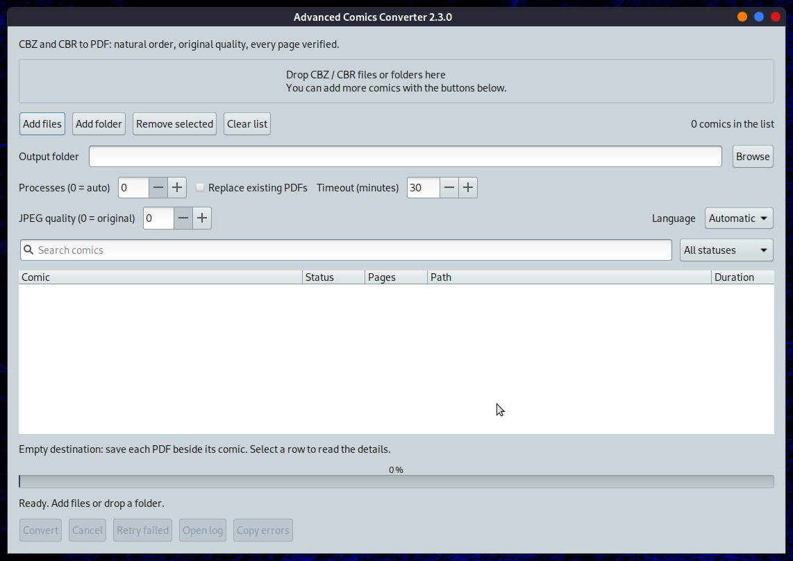

# Advanced Comics Converter (ACC) — Linux 2.3.0

[Versione italiana](#versione-italiana) | [English version](#english-version)

## Download Linux

Download e supporto / Download and support — [Buy Me a Coffee](https://buymeacoffee.com/fconidi/e/489972)


## Versione italiana

Advanced Comics Converter 2.3.0 converte archivi CBZ e CBR in PDF su Linux,
con ordine naturale delle pagine, qualità originale predefinita e verifica
del risultato. La nuova finestra GTK mostra lo stato e le pagine per ogni fumetto,
consente il trascinamento di file e cartelle, l'annullamento e la ripetizione
dei soli lavori falliti. Gli archivi originali restano intatti.

### Schermata della versione 2.3.0



### Installazione e avvio

Per installare il pacchetto 2.3.0, nella cartella che contiene il `.deb`:

```bash
sudo apt install ./advanced-comics-converter_2.3.0_all.deb
advanced-comics-converter --gui
```

Il motore richiede Python 3.11+, img2pdf 0.6+, pikepdf 9+, Pillow 10+ e
rarfile 4.2+. GTK 3/PyGObject è raccomandato per la finestra. Per archivi RAR
serve un decoder come `unrar`, `7z`/`7zz`, `unar` o `bsdtar`. L'app compare nel menu Graphics di MATE.

### Uso

Trascina o aggiungi file e cartelle. Se lasci vuota la destinazione, ogni PDF
viene salvato accanto al fumetto. Lascia la qualità JPEG a 0 per conservare
le immagini originali; scegli un valore da 1 a 100 solo se vuoi ricodificarle.
Imposta processi e timeout, quindi premi **Converti**. La finestra permette di
seguire ogni lavoro, annullare, riprovare i falliti e aprire PDF e log.

Un PDF esistente viene saltato soltanto se è verificabile e corrisponde allo
stesso archivio e alle stesse opzioni. Per sostituire PDF vecchi, estranei o
danneggiati occorre scegliere **Sostituisci PDF esistenti** oppure `--force`.
In caso di errore il PDF precedente resta al suo posto.

```bash
advanced-comics-converter --directory ~/Fumetti --jobs 2
advanced-comics-converter --cli "Tex 001.cbz" "Zagor 002.cbr"
advanced-comics-converter --check-dependencies --require-rar
```

La versione Bash/Zenity precedente è disponibile con `--legacy` come primo
argomento. Usa le sue precedenti dipendenze e il suo precedente comportamento.

## English version

Advanced Comics Converter 2.3.0 converts CBZ and CBR archives to PDF on Linux
with natural page order, original quality by default and verified output.
Its native GTK window supports file and folder drop, per-comic status and page
counts, cancellation and retry of failed jobs. Source archives remain untouched.
The [2.3.0 main-window screenshot](screenshots/main-window-2.3.0.png) is above.

To install the 2.3.0 package from the directory containing the `.deb`:

```bash
sudo apt install ./advanced-comics-converter_2.3.0_all.deb
advanced-comics-converter --gui
```

The engine needs Python 3.11+, img2pdf 0.6+, pikepdf 9+, Pillow 10+ and
rarfile 4.2+. GTK 3/PyGObject is recommended for the desktop. Real RAR comics
also need a decoder such as `unrar`, `7z`/`7zz`, `unar` or `bsdtar`. MATE lists the app in Graphics.

Add or drop files and folders. Leave the output folder empty to save each PDF
beside its comic, and leave JPEG quality at 0 to preserve the original images.
Choose processes and a timeout, then convert. The window shows each job and
can cancel, retry failures, or open PDFs and logs.

An existing PDF is skipped only when it can be verified against the same source
and settings. Old, foreign or invalid PDFs require explicit replacement with
the checkbox or `--force`; a failed conversion preserves the previous PDF.
The previous Bash/Zenity workflow remains available with `--legacy` as the
first argument.

## Versioni precedenti / Previous versions

[Guida della versione 2.1.0 / Version 2.1.0 guide](docs/README-2.1.0.md)

## Licenza e autore / License and author

GPL-3.0-or-later; see the repository's [copyright](copyright) file.
Franco Conidi aka Edmond — [francoconidi.it](https://francoconidi.it) · [SysLinuxOS](https://syslinuxos.com).
